# Hi, I'm Phil

<picture>
  <source media="(prefers-reduced-motion: reduce)" srcset="./assets/terminal-static.svg">
  
</picture>

Software engineer in Columbus, Ohio. I build accessible, well-tested web apps in Vue/Nuxt and React/Next.js, and AI tools are a big part of how I work. **Open to software engineering roles:** reach me on [LinkedIn](https://www.linkedin.com/in/phil-linley).

- Shipped React and Next.js features at Hims & Hers (2024 to 2026) for a telehealth platform serving nearly 3 million customers, backed by Vitest, Playwright, and Datadog
- Led my team's Claude Code rollout: documentation, training sessions, and a custom internal agent
- Built a Claude-powered WCAG audit tool that won the Audience Choice Award at our company hackathon
- Previously built Meta.com launch pages for Meta Quest 3 and Ray-Ban Meta smart glasses
- Run [Lorien Web](https://lorienweb.com), a small studio building accessible Nuxt and Next.js sites for small businesses, churches, and nonprofits

## Client work

Client code is private. Case studies, decision records, and scan results live in my **[portfolio repo](https://github.com/philorien/portfolio)**.

- **[Hope Presbyterian Church](https://github.com/philorien/portfolio/tree/main/case-studies/hope-church)**: Moved a church site off a hosted platform onto Next.js and Sanity, starting from a 22-point audit, with an automated WCAG 2.2 scan of every page. [Live site](https://www.hopechurchcolumbus.org) *Next.js, Sanity, Tailwind CSS, Vercel*
- **[Dragonfly Bookshop](https://github.com/philorien/portfolio/tree/main/case-studies/dragonfly)**: A first website for an independent bookstore, with the catalog pulled from the shop's Square register, online special orders, and events. 1,206 visitors in its first month. [Live site](https://www.dragonflybookshop.com) *Next.js, TypeScript, Square API, Airtable, Vercel*

## Selected work

- **[Green Lantern Watch](https://greenlanternwatch.com)**: An unofficial Green Lantern fan site with news, reading orders, story arc guides, key issues, and a character database, edited in a Sanity Studio embedded in the app. Node scripts pull issue data from the ComicVine API, with caching and rate-limit handling, and sync covers, release dates, and creator credits into Sanity without touching editorial notes. JSON-LD, a sitemap, and an llms.txt help search engines and AI tools find it. 1,000+ page views in its first 24 hours. [Source](https://github.com/philorien/greenlanternwatch) *Next.js 16, React 19, TypeScript, Tailwind CSS v4, Sanity, Vercel*
- **[dcma-site](https://github.com/philorien/dcma-site)**: The [public website](https://www.doorcountymutualaid.org) for Door County Mutual Aid. Editors publish through Sanity without touching code, and a Sanity webhook triggers on-demand ISR so changes go live in seconds. The contact form posts to a validated server API, 50+ Vitest tests cover pages and server logic, and every image requires alt text. *Nuxt 4, Vue 3, TypeScript, Sanity, Vitest, Vercel*
- **[calorie-chat-public](https://github.com/philorien/calorie-chat-public)**: A conversational calorie tracker. Claude looks up foods in USDA and Open Food Facts data, with barcode scanning and prompt caching to keep token costs down. *Next.js, TypeScript, Supabase, Vercel AI SDK*
- **[vue-starter](https://github.com/philorien/vue-starter)**: A Vue 3 and Vite starter with Tailwind v4 and a built-in design system. *Vue 3, Vite, Tailwind CSS*
- **[cbz2epub](https://github.com/philorien/cbz2epub)**: Converts CBZ comic archives to fixed-layout EPUB3, from the command line or a local web UI. The core runs on the Python standard library alone. *Python, Flask*

## Open source

- **[ChurchApps/Api#270](https://github.com/ChurchApps/Api/pull/270)**: In ChurchApps' free church management API, copying a plan now keeps its notes and signup deadline instead of dropping them, with tests for both cases
- **[ChurchApps/B1Transfer#18](https://github.com/ChurchApps/B1Transfer/pull/18)**: In ChurchApps' data import tool, CSV columns now map to a church's own custom person fields (like Membership Date) by name, and anniversaries import correctly, with dates like `9/17/1994` normalized instead of saving blank
- **[activist-org/activist#1939](https://github.com/activist-org/activist/pull/1939)**: Accessibility fixes for an open-source organizing platform, adding alt text to map tooltip images and making an edit toggle keyboard accessible
- **[DieselTech/CBL-ReadingLists#555](https://github.com/DieselTech/CBL-ReadingLists/pull/555)**: Modern Green Lantern reading lists, 823 issues from 2004 through October 2026, plus a 317-issue Kyle Rayner list, a Jeremy Adams run and fixes to five existing lists, with every ComicVine ID checked against the API
- **[AndBible/and-bible#3887](https://github.com/AndBible/and-bible/pull/3887)** (open): Turns off autocorrect in the Bible app's search fields so wildcard searches and suffix-heavy languages aren't rewritten as you type

## How I work

- **Accessibility first.** WCAG 2.2 AA is a requirement, not a polish step. Automated scans catch part of it; keyboard and screen reader testing cover the rest.
- **Tested where it counts.** Vitest for components and server logic, and Playwright for end-to-end flows.
- **Decisions written down.** I write short decision records for the big calls, like [these for Hope Church](https://github.com/philorien/portfolio/tree/main/case-studies/hope-church/decisions): what I chose, what I rejected, and why.
- **AI-assisted, human-reviewed.** I use Claude Code daily. I own the architecture and review everything it writes.

---

Also working toward a BA in sociology at Ohio University. Find me on [LinkedIn](https://www.linkedin.com/in/phil-linley).
